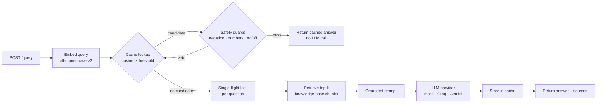
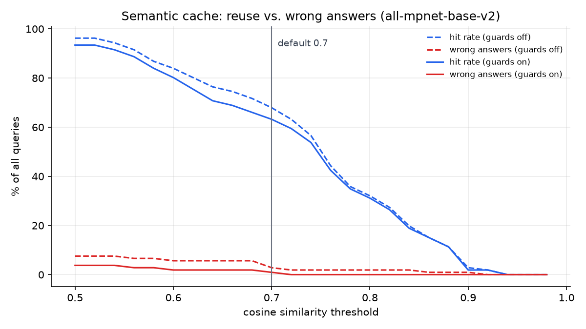
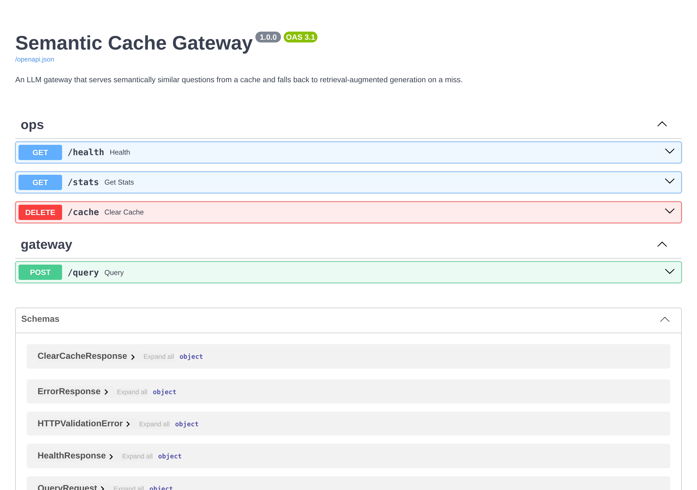
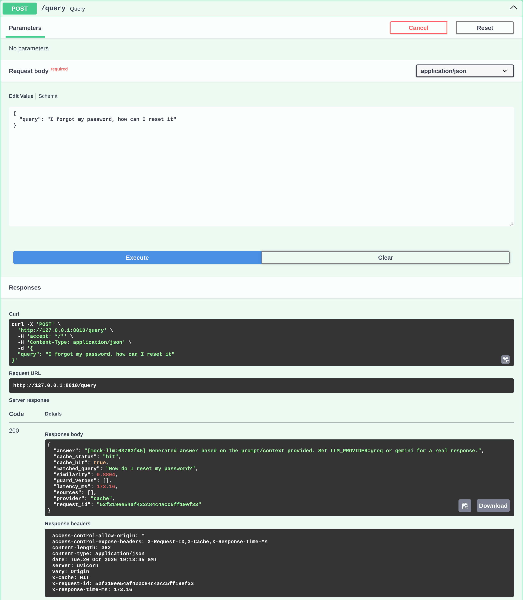
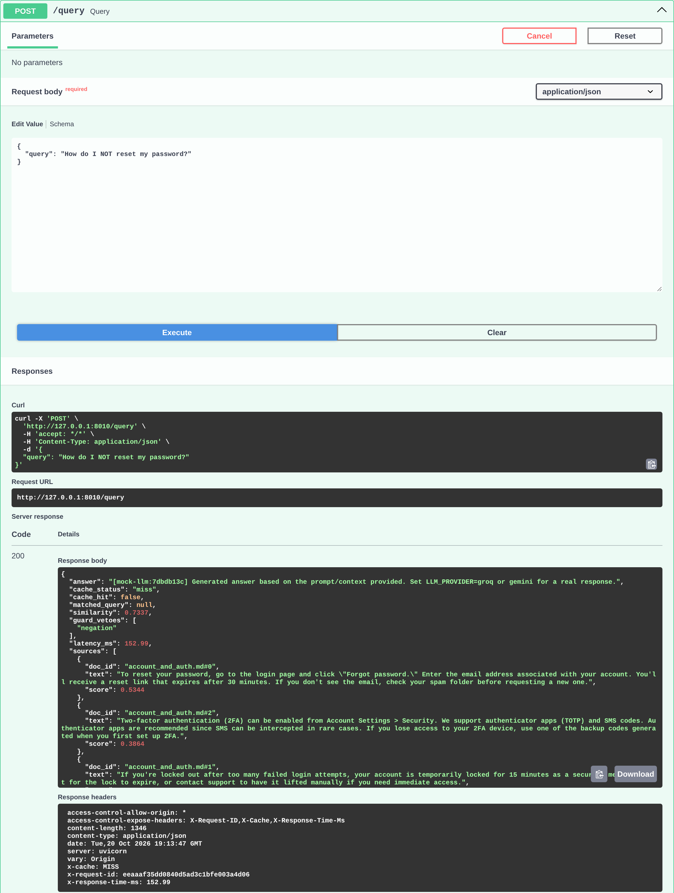
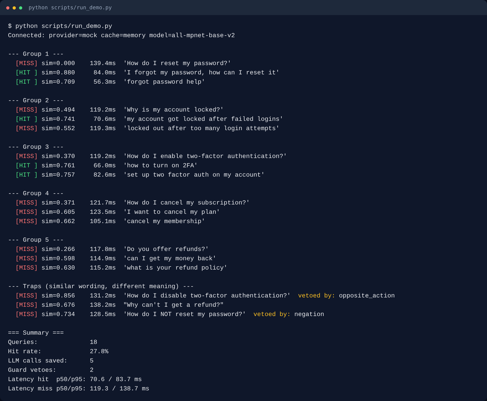
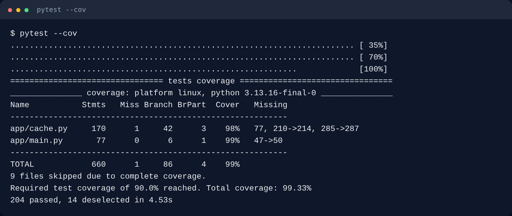

# Semantic Cache Gateway

[](https://github.com/Keerthanajan08/Semantic-Cache-Gateway/actions/workflows/ci.yml)


An LLM gateway that answers **semantically similar** questions from a cache,
not just identical ones, and falls back to retrieval-augmented generation
(RAG) on a miss. It also stops the failure that makes naive semantic caches
dangerous: serving a confident, wrong answer to a question that only
*looks* similar.

| | |
|---|---|
| **63%** of queries served from cache | warm cache, 106 hand-labelled support questions |
| **≤1%** of queries get a wrong answer | measured, not assumed ([eval/results.md](eval/results.md)) |
| **3x fewer wrong answers** from safety guards | 2.8% → 0.9% at the default threshold |
| **~57% lower expected latency** | ~350 ms vs 800 ms per request, with an 800 ms LLM |

## The problem

Support bots and internal Q&A tools get the same question phrased a dozen
ways: *"How do I reset my password?"*, *"forgot password help"*, *"I can't
remember my password"*. An exact-match cache misses all of them, so every
one pays for a full LLM call.

A semantic cache embeds each question and reuses an answer when a previous
question is close enough. The catch is that embeddings capture *topic*, not
*meaning*:

| Cached question | Incoming question | Similarity |
|---|---|---|
| How do I enable two-factor authentication? | How do I **disable** two-factor authentication? | 0.86 |
| Should I enable two-factor authentication? | Should I **not** enable two-factor authentication? | 0.93 |
| What does the **10** seat plan cost? | What does the **50** seat plan cost? | 0.95 |

All of these clear any useful threshold. Without protection, the user who
asked how to *disable* 2FA is told how to *enable* it. This project measures
that risk and then guards against it.

## How it works



1. **Embed** the question with a local sentence-transformers model. No API cost.
2. **Look up** the closest cached questions. A candidate above the
   similarity threshold must also pass the **safety guards**. If the best one
   is vetoed, the next-best is tried.
3. **Hit**: return the cached answer. No retrieval, no LLM call.
4. **Miss**: retrieve the top-k paragraphs from the knowledge base, build a
   grounded prompt ("answer only from this context"), and call the
   configured LLM.
5. **Store** the answer, so the next paraphrase is a hit.

Concurrent requests for the same new question are **coalesced**: a burst of
ten identical questions makes one LLM call, not ten.

## Choosing the threshold and model from data

The threshold is the single most important parameter, and most semantic
cache projects guess it. Here it is measured.

[`scripts/evaluate_threshold.py`](scripts/evaluate_threshold.py) runs a
hand-labelled dataset ([`eval/intents.json`](eval/intents.json): 106
questions, 14 intents) through the real cache code. Several intents are
deliberate near-misses of each other: reset vs. change password, enable vs.
disable 2FA, cancel subscription vs. delete account. Evaluation is
leave-one-out on a warm cache, which is deterministic and reproducible. A
hit is **wrong** when the matched question belongs to a different intent.

The default threshold for each model is the lowest one (most reuse) at which
at most 1% of queries get a wrong answer, there **and at every stricter
threshold**, so it can't sit on a lucky dip before a cliff.



Six embedding models, each at its own best threshold, ranked by **expected
latency per request**: every request pays for an embedding, but only misses
pay for the LLM.

| Model | Threshold | Hit rate | Wrong answers | Embed latency (CPU) | Expected latency* |
|---|---|---|---|---|---|
| **all-mpnet-base-v2** (default) | 0.70 | 63.2% | 0.9% | ~51 ms | **346 ms** |
| BAAI/bge-small-en-v1.5 | 0.86 | 53.8% | 0.9% | ~23 ms | 393 ms |
| all-MiniLM-L6-v2 (original) | 0.74 | 50.9% | 0.9% | ~13 ms | 406 ms |
| all-MiniLM-L12-v2 | 0.76 | 46.2% | 0.9% | ~25 ms | 455 ms |
| BAAI/bge-base-en-v1.5 | 0.86 | 42.5% | 0.9% | ~56 ms | 517 ms |
| thenlper/gte-small | 0.96 | 5.7% | 0.0% | ~37 ms | 792 ms |

<sub>*embed latency + miss rate × 800 ms LLM call. Full sweep and guard
probes in [eval/results.md](eval/results.md).</sub>

What the data showed:

- **The original setup barely worked.** MiniLM at the original threshold
  of 0.90 serves under 5% of queries from cache, even with a warm cache.
  The model and threshold are now chosen by the evaluation.
- **The slowest embedding model gives the fastest gateway.** mpnet is 4x
  slower to embed than MiniLM, but it avoids enough LLM calls to come out
  ~60 ms ahead per request.
- **The guards are what make a useful threshold safe.** At 0.70, guards cut
  wrong answers from 2.8% to 0.9% for 4.7 points of hit rate.
- **gte-small** compresses all similarities into a narrow high band, so no
  threshold separates intents well. It's a reminder that published
  benchmarks don't transfer to every task.

`RECOMMENDED_THRESHOLDS` in [`app/config.py`](app/config.py) stores these
per-model defaults. Change `EMBEDDING_MODEL` and the threshold follows. CI
re-runs the evaluation (`--check`) and fails if a shipped default no longer
matches the data.

## Safety guards

Cheap lexical checks ([`app/guards.py`](app/guards.py)) that can veto a
semantic match:

| Guard | Vetoes | Example |
|---|---|---|
| `negation` | one side negated, the other not | "reset my password" / "**don't** reset my password" |
| `numbers` | different standalone numbers | "order **1234**" / "order **5678**" (but "2FA" is not a number) |
| `opposite_action` | on vs. off verbs | "**turn on** 2FA" / "**turn off** 2FA" |

A guard can only turn a hit into a miss, so its worst case is one extra LLM
call, never a wrong answer. That asymmetry is why it's fine for them to be
simple. Vetoes are reported per response (`guard_vetoes`) and in `/stats`.

## Quick start

**Local** (mock LLM and in-memory cache, no keys or services needed):

```bash
git clone https://github.com/Keerthanajan08/Semantic-Cache-Gateway.git
cd Semantic-Cache-Gateway
python -m venv .venv && source .venv/bin/activate   # Windows: .venv\Scripts\activate
make install            # or: pip install --extra-index-url https://download.pytorch.org/whl/cpu -r requirements-dev.txt
cp .env.example .env
make run                # http://127.0.0.1:8000/docs
```

**Docker** (gateway + Redis, with a persistent cache shared across restarts):

```bash
docker compose up --build
```

Then, in another terminal, run `python scripts/run_demo.py`:

```text
--- Group 1 ---
  [MISS] sim=0.000    113.7ms  'How do I reset my password?'
  [HIT ] sim=0.880     76.1ms  'I forgot my password, how can I reset it'
  [HIT ] sim=0.709     53.0ms  'forgot password help'
...
--- Traps (similar wording, different meaning) ---
  [MISS] sim=0.856    123.6ms  'How do I disable two-factor authentication?'  vetoed by: opposite_action
  [MISS] sim=0.676    133.9ms  "Why can't I get a refund?"
  [MISS] sim=0.734    112.6ms  'How do I NOT reset my password?'  vetoed by: negation
```

The demo starts from an *empty* cache, so its hit rate is lower than the
warm-cache evaluation. Latencies here use the 50 ms mock LLM; with a real
LLM, misses cost hundreds of milliseconds more.

## Screenshots

All captured from a real run of the gateway (mock LLM, in-memory cache).

**Interactive API docs** (`/docs`)



**Cache hit**: a paraphrase is answered from cache (`cache_status: "hit"`,
`X-Cache: HIT`) and matched to the earlier question, with no LLM call.



**Guard veto**: "How do I NOT reset my password?" scores 0.73, above the
0.70 threshold, but the negation guard blocks it (`guard_vetoes: ["negation"]`),
so it goes to RAG + LLM instead of being served the wrong answer.



**Live demo**: paraphrases hitting the cache, and trap questions blocked.



**Test suite**: 204 fast tests, 99% branch coverage.



## API

Interactive docs at `/docs`.

| Endpoint | Purpose |
|---|---|
| `POST /query` | Answer a question: cache hit, or RAG + LLM on a miss |
| `GET /stats` | Hit rate, LLM calls saved, guard vetoes, p50/p95 latency, cache size |
| `GET /health` | Liveness, plus whether the cache backend is reachable (`degraded` if Redis is down) |
| `DELETE /cache` | Empty the cache (requires `ADMIN_TOKEN`; disabled otherwise) |

```bash
curl -X POST localhost:8000/query -H 'Content-Type: application/json' \
     -d '{"query": "I forgot my password, how can I reset it"}'
```

```json
{
  "answer": "[mock-llm:63763f45] Generated answer based on the prompt/context provided. ...",
  "cache_status": "hit",
  "cache_hit": true,
  "matched_query": "How do I reset my password?",
  "similarity": 0.8804,
  "guard_vetoes": [],
  "latency_ms": 91.74,
  "sources": [],
  "provider": "cache",
  "request_id": "a2c52524728b4431ba12611641dceb65"
}
```

- `"use_cache": false` forces a fresh answer, which also refreshes the cache.
- Responses carry `X-Cache: HIT|MISS|BYPASS`, `X-Response-Time-Ms` and
  `X-Request-ID`. An incoming `X-Request-ID` is propagated, so logs
  correlate end to end.
- An LLM failure returns a clean `502`, and the failure is never cached.
  A missing API key returns `503` and also fails start-up, so a bad deploy
  is caught before users see it.

## Configuration

All settings are environment variables (or `.env`), validated at start-up.
A typo like `LLM_PROVIDER=grok` stops the server instead of silently
misbehaving. See [`.env.example`](.env.example).

| Variable | Default | Notes |
|---|---|---|
| `LLM_PROVIDER` | `mock` | `mock` (offline, deterministic), `groq`, `gemini` |
| `GROQ_MODEL` / `GEMINI_MODEL` | `openai/gpt-oss-20b` / `gemini-3.5-flash-lite` | Current models on each provider's free tier |
| `REDIS_URL` | empty | Empty = in-memory. Set it to persist and share across replicas |
| `EMBEDDING_MODEL` | `all-mpnet-base-v2` | ~810 MB RAM; `all-MiniLM-L6-v2` needs ~530 MB |
| `CACHE_SIMILARITY_THRESHOLD` | per model | Leave unset to use the evaluated default |
| `CACHE_TTL_SECONDS` | `86400` | Stale answers age out; `0` disables expiry |
| `CACHE_MAX_ENTRIES` | `10000` | In-memory LRU cap. With Redis, use `maxmemory-policy` |
| `CACHE_GUARDS` | `true` | Negation, number and on/off safety checks |
| `LLM_TIMEOUT_SECONDS` | `30` | The SDK retries 429/5xx with backoff |
| `ADMIN_TOKEN` | empty | Enables `DELETE /cache` |

## Design decisions

- **Exact nearest-neighbour search, vectorised.** Cached embeddings sit in
  one `(N, d)` float32 matrix, so a lookup is a single matrix-vector
  product: about 3 ms at 10k entries, and exact. Redis stores vectors as
  compact float32 bytes (base64) and fetches every entry in **one pipelined
  round trip**. Plain Redis is enough, with no RediSearch module, so free
  hosted tiers work. Past ~100k entries, the answer is an ANN index (Redis
  vector sets, FAISS, pgvector) behind the same `BaseCache` interface.
- **Cache keys are namespaced by embedding model.** Vectors from different
  models live in different spaces. Switching models must never compare
  them, so the old entries become invisible instead of wrong.
- **The gateway is separate from HTTP.** `app/gateway.py` owns the flow and
  `app/main.py` only handles validation, headers, errors and logging, so
  the core is unit-tested without a web server.
- **Single-flight per question.** Concurrent misses for the same question
  wait for the first one and are then served from the cache.
- **Bounded everything.** TTL plus an LRU cap on the cache, fixed windows for
  latency percentiles, and Redis `maxmemory` with `allkeys-lru` in compose.
  Memory stays flat under load.
- **Warm-up at start-up.** The model, knowledge base, provider and cache are
  loaded before the first request, so request #1 isn't charged seconds of
  model loading, and misconfiguration fails the deploy.
- **Pluggable providers with normalised errors.** Every SDK failure
  (timeout, rate limit, auth, empty or blocked response) becomes
  `LLMProviderError` and maps to one `502`.

## Testing and quality

```bash
make check       # ruff + mypy --strict + 204 fast tests with coverage gate
make test-all    # + 14 integration tests with the real embedding model
make eval        # regenerate eval/results.md and the chart
```

- **218 tests, 99% branch coverage.** The fast suite runs in about 3
  seconds with no network: a deterministic bag-of-words fake embedder,
  `fakeredis`, and stubbed Groq/Gemini SDKs.
- **Both cache backends run the same contract tests**, plus
  backend-specific ones: LRU, TTL, namespace isolation, and a test that
  fails if Redis lookups ever go back to one round trip per key.
- **Concurrency is tested.** One test proves that 8 simultaneous identical
  misses make exactly 1 LLM call.
- **Regression tests for every bug fixed.** Examples: whitespace-only
  queries reaching the LLM, a provider typo silently using the mock, and
  "2FA" being read as the number 2.
- **Mutation-checked.** Deliberately breaking the guards, single-flight,
  LRU, TTL, Redis expiry, error handling or the bounded stats window each
  fails at least one test.
- **CI** ([`.github/workflows/ci.yml`](.github/workflows/ci.yml)):
  - lint and strict type-checking
  - tests on Python 3.11, 3.12 and 3.13
  - real-model integration tests
  - the threshold-reproduction check
  - a Docker build with a container smoke test

## Deploying

| Piece | Option | Notes |
|---|---|---|
| Gateway | Render / Railway / Fly.io (Docker) | The image bakes in the model and runs as non-root, with a healthcheck |
| Redis | Upstash / Redis Cloud free tier | Works on plain Redis; no modules needed |
| LLM | Groq or Gemini free tier | Set `LLM_PROVIDER` and the API key |

The image is about 2 GB: CPU-only torch (~770 MB) plus mpnet (~420 MB).

**Memory:** the running server uses about **810 MB** with mpnet and about
**530 MB** with MiniLM (measured RSS after warm-up), mostly torch itself.
**Neither fits a 512 MB free instance**, so plan on a 1 GB instance. To
trade some hit rate for memory, build with
`--build-arg EMBEDDING_MODEL=all-MiniLM-L6-v2`; the threshold adjusts
automatically. Getting under 512 MB would mean dropping torch for an ONNX
runtime (see below).

## Limitations and next steps

- **The evaluation set is small** (106 questions, one domain). It's enough
  to show the trade-offs and choose defaults, but not to promise exact
  rates on other traffic. Re-run `make eval` on your own labelled
  questions.
- **The guards are English and lexical.** The one wrong answer left at the
  default threshold is "I want to *stop using* an authenticator app" being
  served the answer to "how can I *secure my account with* an authenticator
  app" (0.70). The guard can't see a direction on both sides of that pair. A
  small cross-encoder re-ranking the top candidates would catch it, at
  ~10-20 ms extra per hit.
- **Single-flight is per process.** Across replicas it would need a Redis
  lock (`SET NX PX`).
- **The cache doesn't know when the knowledge base changes.** TTL bounds
  the staleness. Versioning the namespace with a KB hash would make
  invalidation instant.
- **Memory is dominated by torch.** Exporting the embedding model to ONNX
  and serving it with `onnxruntime` would cut RAM and image size
  substantially, enough to target 512 MB hosts.
- **Metrics are in-process.** A multi-replica deployment would export them
  via Prometheus or OpenTelemetry.

## Project structure

```
app/
  main.py               HTTP layer: validation, request IDs, headers, error mapping, lifespan
  gateway.py            request flow: embed → lookup → guards → RAG → LLM → store; single-flight
  cache.py              BaseCache / InMemoryCache (LRU + TTL) / RedisCache (pipelined, namespaced)
  guards.py             negation, number and opposite-action safety checks
  embeddings.py         sentence-transformers wrapper (lazy torch import)
  rag.py                knowledge-base chunking, vectorised retrieval, grounded prompt
  llm_providers.py      mock / Groq / Gemini with timeouts and normalised errors
  stats.py              thread-safe metrics with bounded latency windows
  config.py             validated settings, per-model threshold defaults
  schemas.py            request/response models
  knowledge_base/       sample FAQ docs for RAG
eval/
  intents.json          106 labelled questions across 14 intents
  guard_probes.json     trap pairs that must never share an answer
  results.md            generated: model comparison, threshold sweep, guard probes
  threshold_sweep.png   generated chart
docs/screenshots/       README screenshots from a real run
scripts/
  evaluate_threshold.py threshold and model evaluation (+ --check for CI)
  run_demo.py           live demo against a running gateway
tests/                  218 tests: unit, API, concurrency, eval methodology, real-model integration
Dockerfile              multi-stage, CPU torch, model baked in, non-root, healthcheck
docker-compose.yml      gateway + Redis (bounded memory, LRU, persistence)
```
